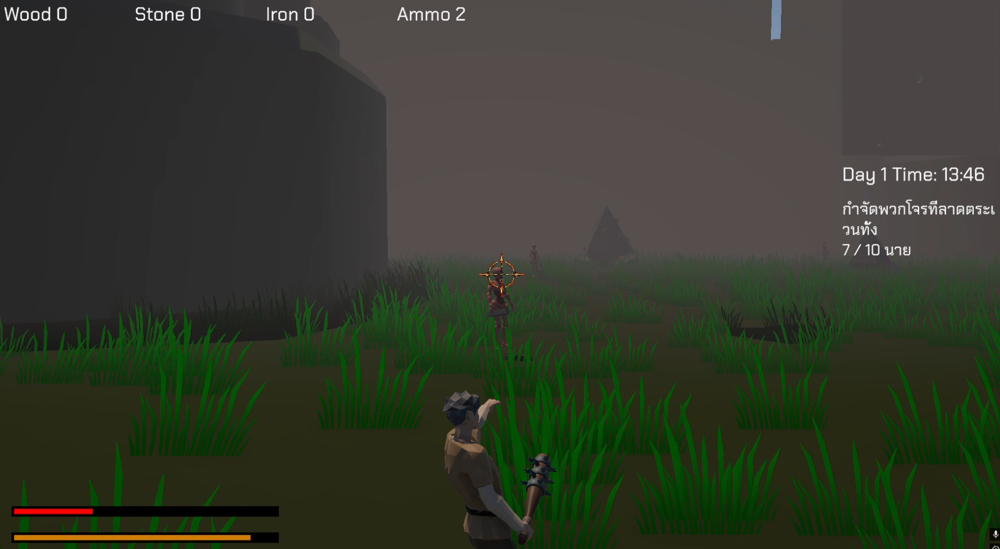
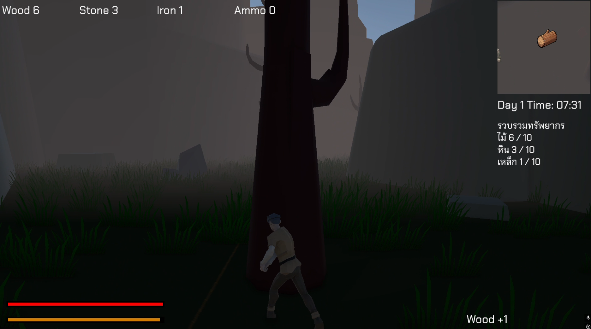
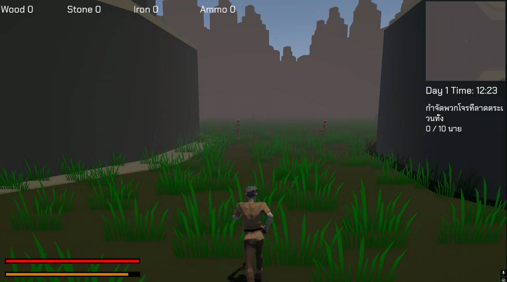
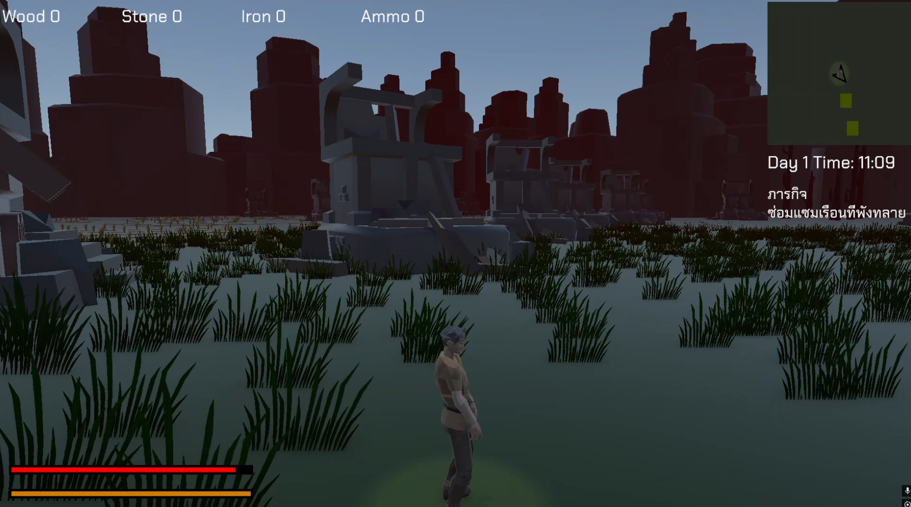
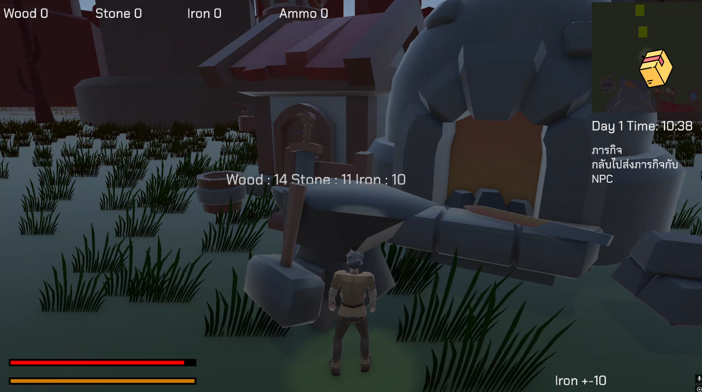
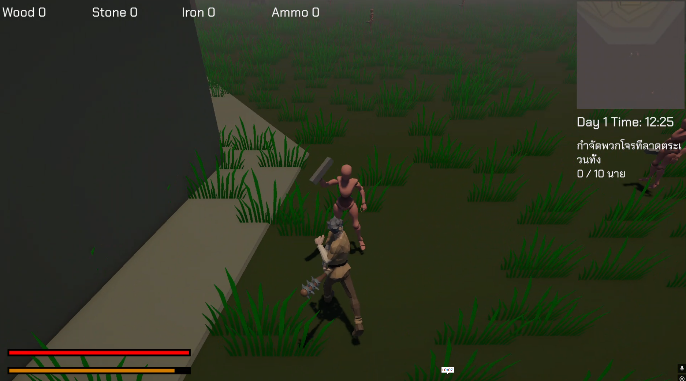
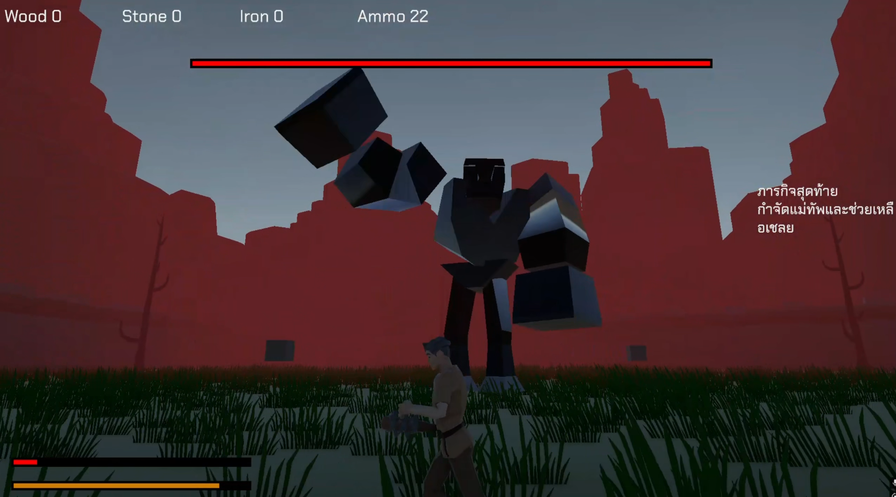

# Khun Phrai Game Project
โปรเจกต์เกม Soulslike Survival ในโลกของวรรณคดีไทย

# Project Overview
- **My Role:** Game Designer / Level Designer / System Designer
- **Engine & Tools:** Unity Engine / Blender(3D Asset Design)
- **Genre & Platform:** Soulslike Survival (PC)
- **Project Status:** Completed Project

# What is Khun Phrai Game?
- **Khun Phrai (ขุนพราย)** เป็นเกมแนว **Soulslike / Survival** สำหรับผู้เล่นที่ชื่นชอบการต่อสู้ที่ท้าทายและการเอาชีวิตรอดในโลกที่เต็มไปด้วยอันตราย
ด้วยงานภาพสไตล์ **Low-poly 3D** ที่ได้รับแรงบันดาลใจจากสภาพแวดล้อมไทยโบราณ **บนแพลตฟอร์ม PC**

- ตัวเกมนำวรรณคดีไทยเรื่อง **ขุนช้างขุนแผน** มาตีความใหม่ในโลกแฟนตาซี ท่ามกลางสงครามอาคมมืด ความเชื่อเรื่องไสยศาสตร์
ผู้เล่นจะได้สัมผัสการต่อสู้ที่ต้องอาศัยทักษะ การอ่านท่าทางและการจับจังหวะ พร้อมใช้คาถาอาคมเป็นส่วนหนึ่งของการต่อสู้ ควบคู่ไปกับการสำรวจเพื่อรวบรวมทรัพยากร ช่วยเหลือชาวบ้านและฟื้นฟูบ้านเกิดที่ล่มสลาย

# Key Features
- **ระบบการต่อสู้ด้วยไสยศาสตร์ไทย**
> 
- **การสำรวจพื้นที่อันตราย เพื่อรวบรวมทรัพยากร**
> 
> 
- **การฟื้นฟูหมู่บ้าน**
> 
> 
- **การต่อสู้กับเหล่าศัตรู**
> 
- **การต่อสู้กับแม่ทัพเพื่อช่วยเหลือชาวบ้านที่ตกเป็นเชลย**
> 

# Link
- [Intro Video](https://youtu.be/CqWHmPapPRg?si=aEk3hbZCRT6qAFp-)
- [Trailer Video](https://youtu.be/nt1PYpG0r6o?si=mtsYAJ0_oCybok30)
- [GamePlay Video](https://youtu.be/cRK7fxyCs7g?si=ltotAHz2-et_CBdg)
- [GDD](GDD.md)
